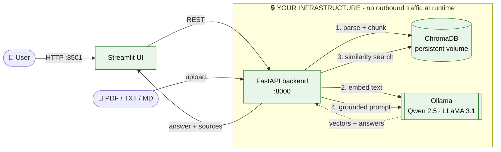

<div align="center">

<!-- Replace with your logo: docs/assets/logo.png (recommended 240x240, transparent PNG) -->


# VaultRAG

### Private AI for your documents. On your servers. Zero data egress. Zero API fees.

**Self-hosted RAG infrastructure for teams that can't - and shouldn't - send contracts, patient files and internal knowledge to a third-party AI API.**

<br/>

[](LICENSE)
[](https://www.python.org/)
[](src_lite/docker-compose.yml)
[](#security--compliance)
[](#the-problem)
[](https://fastapi.tiangolo.com/)
[](https://ollama.com/)

<br/>

<table>
<tr>
<td align="center" bgcolor="#0b1f3a">

## 🚀 Need it in production this week?

**VaultRAG Enterprise - the complete, hardened stack. One-time payment. Full source code. No subscription.**

### [👉 GET VAULTRAG ENTERPRISE - $99 FOR A LIMITED TIME 👈](https://whop.com/linkedin-1cc8/vaultrag-enterprise-starter-kit/)

[](https://whop.com/checkout/YOUR_PRODUCT_ID)

<sub>API-key auth · validated citations · PDF/DOCX/CSV/TXT · per-document erasure · GPU profile · air-gapped guide</sub>

</td>
</tr>
</table>

[Quick start](#quick-start-lite-edition) · [Lite vs. Enterprise](#lite-vs-enterprise) · [Architecture](#architecture) · [Security](#security--compliance) · [Contributing](CONTRIBUTING.md)

</div>

---

## The Problem

Every "chat with your documents" tool your team tries ends the same way: the files go to someone else's servers.

| Cloud RAG / LLM APIs | The consequence |
|---|---|
| 📤 **Your documents become third-party data.** Contracts, HR files, patient notes and source code are transmitted to an external processor. | Every upload must be justified to your DPO, auditor and clients. Sub-processors multiply on your risk register. |
| 💸 **Usage-based pricing punishes adoption.** Per-token and per-seat fees scale with how much your team relies on the tool. | Budgets become unpredictable precisely when the tool starts working. |
| 🔒 **Vendor lock-in.** Models, prices and terms change on someone else's schedule. | Your workflow can break - or get expensive - overnight. |
| 🧾 **Answers without proof.** A response you can't trace to a source page is a response you can't trust. | Hallucinations reach decisions, reports and customers. |

## The Solution

**VaultRAG runs the entire retrieval-augmented generation pipeline inside your own perimeter.** Parsing, embeddings, vector search and LLM generation all happen on hardware you control, using open models served by [Ollama](https://ollama.com) (Qwen 2.5, LLaMA 3.1, Mistral and more).

- ✅ **Zero data egress by design** - documents, questions, embeddings and answers never leave your network at runtime.
- ✅ **Zero API fees** - no OpenAI, Anthropic or Google key. Costs are your own hardware, not per-token meters.
- ✅ **Compliance-friendly architecture** - no third-party processor to list in your DPA, no telemetry, localhost-only by default.
- ✅ **Deploy in minutes** - `docker compose up`, and you have an API, a Swagger playground and a chat UI.
- ✅ **Open foundation** - MIT-licensed Lite edition you can read, audit and fork today.

---

## Lite vs. Enterprise

The **Lite** edition in this repository is a fully working, MIT-licensed RAG backend - perfect for evaluating the architecture, learning, and personal projects. **Enterprise** is the production-hardened stack for teams who need security controls, reliability and trustworthy answers.

| Capability | 🆓 **Lite** (this repo) | 🏢 **Enterprise** ($149) |
|---|:---:|:---:|
| **License** | MIT | Commercial license, full source code |
| **Price** | Free | **$149 one-time** - no subscription, no per-seat fees |
| **100% local pipeline** (Ollama + ChromaDB) | ✅ | ✅ |
| **Zero telemetry** | ✅ | ✅ |
| **Chat UI (Streamlit)** | ✅ Basic | ✅ Full: model switcher, document library, source viewer |
| **File formats** | TXT, Markdown, PDF | **PDF, DOCX (incl. tables), CSV, TXT** |
| **Max upload size** | 10 MB (configurable) | 50 MB, enforced while streaming |
| **Embeddings** | Ollama `nomic-embed-text` | Baked-in `sentence-transformers` (MiniLM / **BGE-M3 multilingual**), no runtime downloads |
| **Vector store** | Embedded ChromaDB | Dedicated ChromaDB server container with healthchecks |
| **Retrieval quality controls** | Top-K only | **Relevance threshold gate** - below-threshold queries never reach the LLM |
| **Answer citations** | Retrieved passages shown | **Numbered `[n]` citations validated against the passages the model actually saw**; invented references stripped |
| **Hallucination safeguards** | Basic grounded prompt | Grounded prompt + `[[NO_ANSWER]]` protocol + `grounded` flag + warnings |
| **Prompt-injection hardening** | Basic | Passages treated as untrusted data, strict output validation |
| **API authentication** | ❌ (localhost use) | ✅ `X-API-Key` with constant-time comparison |
| **Right-to-erasure endpoint** | ❌ | ✅ `DELETE /documents/{id}` removes all vectors and text |
| **Idempotent re-ingestion** (same file = replace) | Basic (by filename) | ✅ Content-hash based |
| **Error envelope + request IDs** | Basic HTTP errors | ✅ Unified JSON errors, `X-Request-ID` on every response |
| **Structured JSON logging** | ❌ | ✅ |
| **Liveness / readiness probes** (K8s-ready) | Basic `/health` | ✅ `/health` + dependency-aware `/health/ready` |
| **Memory tuning** (batching, concurrency, limits) | ❌ | ✅ Runs big PDFs on small machines |
| **NVIDIA GPU profile** | ❌ | ✅ `docker-compose.gpu.yml` |
| **Air-gapped deployment guide** | ❌ | ✅ Image + model export, `internal: true` network |
| **Hardened containers** (non-root, localhost bind, unpublished DB/LLM ports) | Partial | ✅ |
| **Support** | Community, best-effort | Priority access via Whop; custom integrations on request |

> **The honest summary:** Lite proves the concept in 10 minutes. Enterprise is what you put in front of your colleagues, your legal team and your auditors.

<div align="center">

### [🏢 Upgrade to VaultRAG Enterprise - $99 one-time →](https://whop.com/linkedin-1cc8/vaultrag-enterprise-starter-kit/)

*One payment. Full source code. No subscription, no per-token meter.*

</div>

---

## Architecture

Everything below runs on **your** hardware. The only outbound connection in the whole system is the one-time model download.



**Ingestion** - `file → validate → parse → chunk (800 / 150 overlap) → embed locally → ChromaDB upsert`

**Query** - `question → embed locally → top-K cosine search → numbered passages → local LLM → answer + sources`

### Technology stack

| Layer | Technology |
|---|---|
| API | FastAPI, Pydantic v2, Uvicorn |
| Vector database | ChromaDB (persistent, cosine similarity) |
| LLM runtime | Ollama - Qwen 2.5, LLaMA 3.1, Mistral, or any model you pull |
| UI | Streamlit |
| Packaging | Docker & Docker Compose |

---

## Quick Start (Lite Edition)

**Requirements:** Docker with Compose v2 · ~10 GB free disk · 16 GB RAM recommended (8 GB works with a smaller model) · an NVIDIA GPU is optional but makes answers much faster.

### Option A - Docker (recommended)

```bash
git clone https://github.com/YOUR_ORG/vaultrag.git
cd vaultrag/src_lite

docker compose up -d --build
docker compose logs -f ollama-pull      # first start only: downloads the models (~5 GB)
```

When the download finishes, open:

| URL | What |
|---|---|
| http://localhost:8501 | Chat UI - upload documents and ask questions |
| http://localhost:8000/docs | Swagger API playground |
| http://localhost:8000/health | Status of the backend and the Ollama models |

Pick different models without editing any file:

```bash
LLM_MODEL=llama3.1:8b docker compose up -d
```

Stop everything with `docker compose down` (add `-v` to also delete the indexed documents and models).

### Option B - Manual (no Docker)

1. Install [Ollama](https://ollama.com/download) and pull the models:

   ```bash
   ollama pull qwen2.5:7b
   ollama pull nomic-embed-text
   ```

2. Create a virtual environment and install dependencies (Python 3.11+):

   ```bash
   cd vaultrag/src_lite
   python -m venv .venv
   source .venv/bin/activate            # Windows: .venv\Scripts\activate
   pip install -r requirements.txt
   ```

3. Start the backend and the UI in two terminals:

   ```bash
   uvicorn main:app --reload            # API on http://localhost:8000
   streamlit run app.py                 # UI  on http://localhost:8501
   ```

### Try the API

```bash
# Upload documents
curl -F "files=@contract.pdf" -F "files=@notes.md" http://localhost:8000/api/v1/upload

# Ask a question
curl -X POST http://localhost:8000/api/v1/query \
  -H "Content-Type: application/json" \
  -d '{"question": "What is the notice period in the supplier agreement?"}'
```

```json
{
  "answer": "The notice period is ninety days written notice by either party.",
  "sources": [
    { "source": "contract.pdf", "page": 2, "snippet": "Termination: the notice period is ninety days...", "score": 0.71 }
  ],
  "model": "qwen2.5:7b",
  "latency_ms": 4210
}
```

### Configuration

All settings are environment variables:

| Variable | Default | Purpose |
|---|---|---|
| `LLM_MODEL` | `qwen2.5:7b` | Any model available in Ollama (`llama3.1:8b`, `mistral`, ...) |
| `EMBEDDING_MODEL` | `nomic-embed-text` | Ollama embedding model (re-upload documents after changing it) |
| `OLLAMA_BASE_URL` | `http://localhost:11434` | Where your Ollama server lives |
| `CHUNK_SIZE` / `CHUNK_OVERLAP` | `800` / `150` | Chunking behaviour |
| `TOP_K` | `4` | Passages retrieved per question |
| `MAX_UPLOAD_MB` | `10` | Per-file upload limit |
| `CHROMA_PERSIST_DIR` | `./data/chroma` | Where the index is stored |

### Troubleshooting

| Symptom | Fix |
|---|---|
| UI shows "Missing models" | The first download is still running. Check `docker compose logs -f ollama-pull`. |
| First question is very slow | Ollama is loading the model into memory; later questions are faster. A GPU helps dramatically. |
| Answers say "could not find this" | Rephrase the question, raise `TOP_K`, or check that the PDF is not a scan (no OCR in Lite). |
| Non-English documents answer poorly | Use a multilingual embedding model (`EMBEDDING_MODEL=bge-m3` after `ollama pull bge-m3`) and re-upload. |

> **Lite limits:** no authentication (keep it on localhost), no OCR, no per-document deletion, no answer-citation validation. These are exactly what Enterprise adds - see the [comparison](#lite-vs-enterprise).

---

## Security & Compliance

VaultRAG is designed so that the compliance conversation is short.

**Our declaration**

- 🚫 **No telemetry.** ChromaDB anonymized telemetry is disabled in code and in the container environment. Streamlit usage statistics are disabled. VaultRAG contains no analytics, tracking, crash reporting or update checks.
- 🔒 **No outbound traffic at runtime.** The only network access is to your own Ollama instance. Models are downloaded once, then the stack works with the network cut.
- 🏠 **Data residency is your residency.** Documents, embeddings, questions and answers live in Docker volumes on your machine.
- 🧱 **Least exposure by default.** The API and UI bind to `127.0.0.1`; Ollama is never published to the host.
- 👤 **Non-root containers** and an allow-list of file types with upload size limits.

**What this means for GDPR / HIPAA-sensitive environments**

| Requirement area | How the architecture helps |
|---|---|
| Third-party processors (GDPR Art. 28) | No external processor is involved at runtime - nothing to add to your DPA for the AI layer |
| Data minimisation & purpose limitation | Original upload files are not retained; only text chunks and vectors are stored |
| Right to erasure (GDPR Art. 17) | Enterprise: one API call deletes a document and every derived vector |
| Data transfer restrictions | No cross-border transfers - data never leaves the host |
| Technical safeguards (HIPAA Security Rule) | Local processing and network isolation support your safeguards; encryption, access control and audit controls remain yours to configure |

> **Important:** VaultRAG provides a *compliance-friendly architecture*. It is **not** a certification, and no software alone makes an organisation GDPR- or HIPAA-compliant. TLS termination, disk encryption, user-level access control, audit logging, backups, retention policies and your legal assessment (DPIA, BAA, etc.) remain your responsibility. Please engage your compliance officer.

Found a vulnerability? Read our [Security Policy](SECURITY.md) and report it privately.

---

## FAQ

**Is Lite really free? What's the catch?**
Yes - MIT-licensed, no registration, no usage caps (the 10 MB upload limit is configurable). Enterprise funds continued development of the whole project.

**Can I use Lite commercially?**
Yes, the MIT license allows it. For anything business-critical, we recommend Enterprise's authentication, validated citations and operational tooling.

**What hardware do I need?**
A 7-8B model runs on 16 GB RAM (CPU-only is workable for small teams, but slow). An NVIDIA GPU with 8 GB+ VRAM gives answers in seconds.

**Does Enterprise need an internet connection?**
Only for the initial model download. After that it runs fully offline, and the Enterprise guide shows how to deploy on air-gapped hosts.

**What do I get when I buy Enterprise?**
The complete source code of the production stack, the Docker Compose files (including the GPU profile), configuration reference and deployment guides - delivered through Whop.

**Is there a refund policy?**
Refund terms are shown on the [Whop checkout page](https://whop.com/checkout/YOUR_PRODUCT_ID) before you pay.

---

## Roadmap (Lite)

- [x] Local embeddings and generation through Ollama
- [x] PDF, TXT, Markdown ingestion
- [x] Docker Compose one-command setup
- [ ] Automated test suite and CI
- [ ] Streaming responses
- [ ] Windows / ARM compatibility notes

Have an idea? Open an issue or a Discussion.

---

## Contributing

PRs are welcome - bug fixes, docs, tests and compatibility improvements especially. Please read [CONTRIBUTING.md](CONTRIBUTING.md) first. Need SLA-backed support or a custom integration? Use the [Enterprise Support template](.github/ISSUE_TEMPLATE/enterprise_support.md).

## ⭐ Support the project

If VaultRAG saves you from sending your documents to a cloud API, **please star the repository** - it helps other privacy-conscious teams find it.

## License

The Lite edition in this repository is released under the [MIT License](LICENSE). VaultRAG Enterprise is distributed separately under a commercial license.

---

<div align="center">

**Your documents. Your servers. Your answers.**

### [🏢 Get VaultRAG Enterprise - $99 one-time →](https://whop.com/linkedin-1cc8/vaultrag-enterprise-starter-kit/)

</div>

<details>
<summary><b>Topics & keywords</b></summary>

<br/>

`rag` · `retrieval-augmented-generation` · `local-llm` · `self-hosted` · `privacy` · `offline-ai` · `ollama` · `chromadb` · `fastapi` · `streamlit` · `docker` · `docker-compose` · `llama3` · `qwen` · `gdpr` · `hipaa` · `enterprise-ai` · `document-qa` · `vector-database` · `on-premise`

*Maintainers: add these under **Repository → About → Topics** (GitHub allows up to 20), and use this as the About description:*
> Self-hosted, 100% offline RAG starter kit. FastAPI + ChromaDB + Ollama (Qwen 2.5 / LLaMA 3.1) + Streamlit. Zero data egress, zero API fees, GDPR/HIPAA-friendly architecture.

</details>
